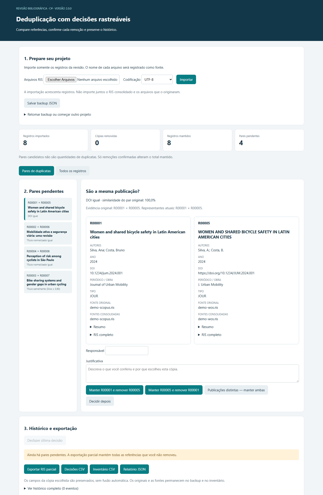
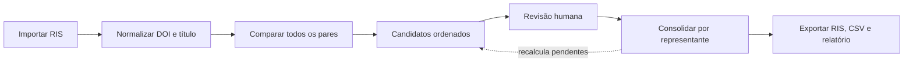
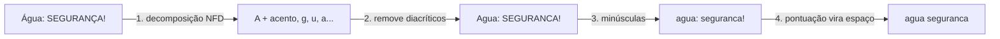
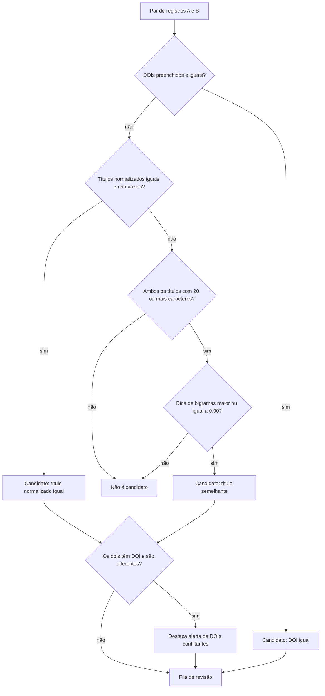
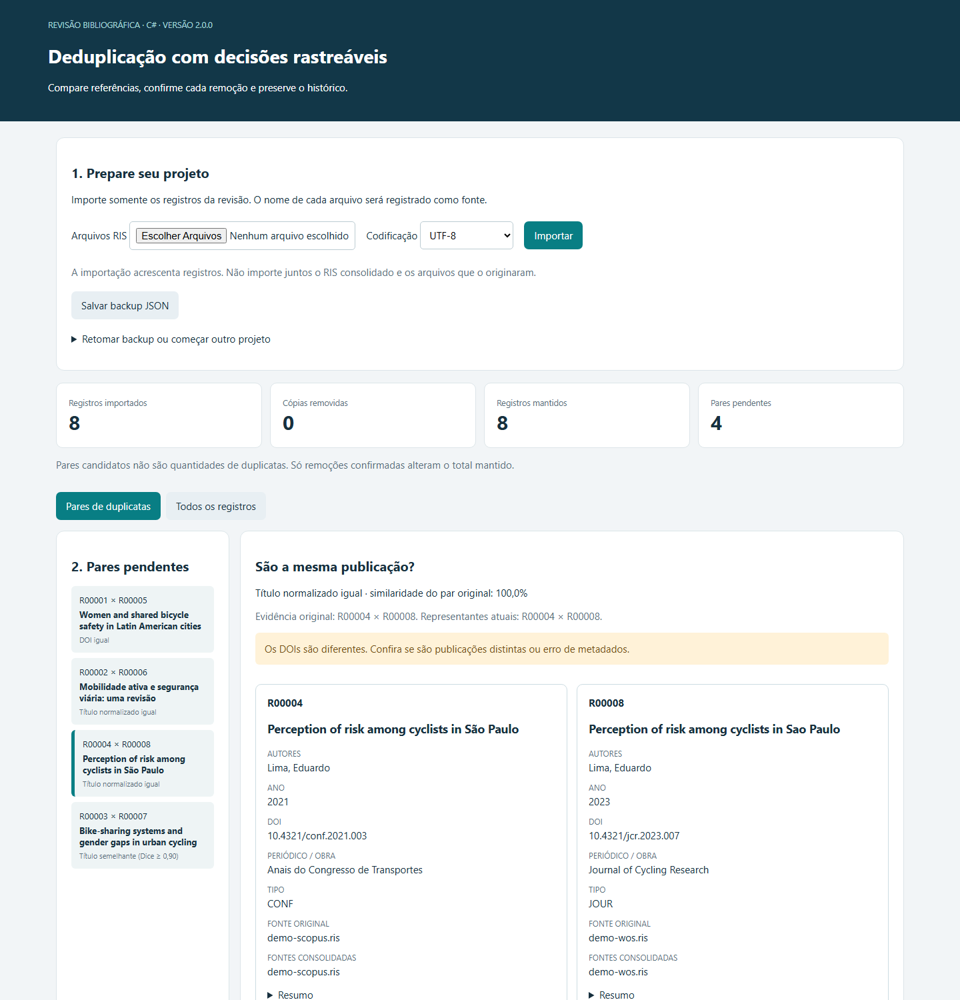
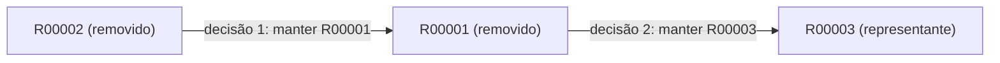
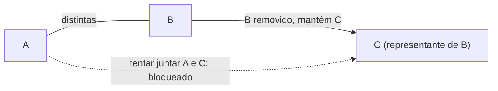
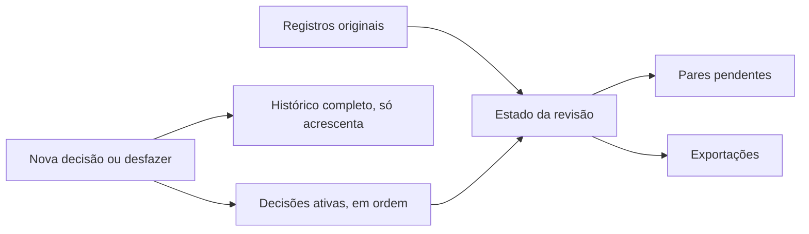
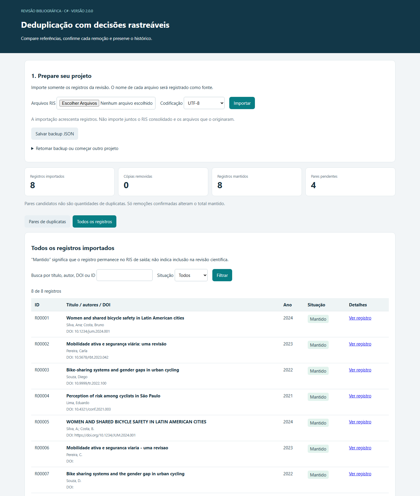

<div align="center">

# AppDeduplicacaoRIS

**Deduplicação supervisionada de referências bibliográficas RIS para revisões sistemáticas.**

O software sugere, a pessoa decide e tudo fica registrado.




</div>

---

## Sumário

- [O problema](#o-problema)
- [Visão geral do fluxo](#visão-geral-do-fluxo)
- [Etapa 1: leitura dos arquivos RIS](#etapa-1-leitura-dos-arquivos-ris)
- [Etapa 2: normalização](#etapa-2-normalização)
- [Etapa 3: comparação par a par](#etapa-3-comparação-par-a-par)
- [Etapa 4: critérios de candidatura](#etapa-4-critérios-de-candidatura)
- [O coeficiente de Dice de bigramas](#o-coeficiente-de-dice-de-bigramas)
- [Etapa 5: revisão supervisionada](#etapa-5-revisão-supervisionada)
- [Etapa 6: consolidação transitiva](#etapa-6-consolidação-transitiva)
- [Etapa 7: exportação e rastreabilidade](#etapa-7-exportação-e-rastreabilidade)
- [Exemplo completo](#exemplo-completo)
- [Limitações e uso científico](#limitações-e-uso-científico)
- [Como executar](#como-executar)
- [Estrutura do projeto](#estrutura-do-projeto)

---

## O problema

Uma revisão sistemática costuma pesquisar várias bases (Scopus, Web of Science, PubMed, SciELO...). Cada base exporta as próprias referências em **RIS**, e o mesmo artigo aparece várias vezes, com pequenas diferenças:

| Base | Título | DOI |
| --- | --- | --- |
| Scopus | Women and shared bicycle safety in Latin American cities | `10.1234/jum.2024.001` |
| Web of Science | WOMEN AND SHARED BICYCLE SAFETY IN LATIN AMERICAN CITIES | `https://doi.org/10.1234/JUM.2024.001` |

Para um computador, essas duas linhas são diferentes. Para quem está revisando, é o mesmo artigo. Já um artigo de congresso e o artigo de periódico que o sucedeu podem ter **o mesmo título e ser publicações distintas**.

Por isso a aplicação **não apaga nada sozinha**. Ela:

1. encontra pares **candidatos** com critérios simples e explicáveis;
2. mostra os metadados lado a lado;
3. exige que uma pessoa confirme cada decisão, com responsável e justificativa;
4. guarda o histórico completo para que a deduplicação possa ser auditada e relatada (por exemplo, no fluxograma PRISMA).

---

## Visão geral do fluxo



Cada etapa é determinística: com os mesmos arquivos e as mesmas decisões, o resultado é sempre o mesmo. Não há IA, consulta a serviços externos nem aleatoriedade.

---

## Etapa 1: leitura dos arquivos RIS

RIS é um formato de texto em que cada linha tem uma *tag* de duas letras:

```text
TY  - JOUR                      <- início do registro (tipo)
TI  - Women and shared bicycle safety in Latin American cities
AU  - Silva, Ana                <- campos podem se repetir
AU  - Costa, Bruno
PY  - 2024
DO  - 10.1234/jum.2024.001
AB  - Primeira linha do resumo
      continuação do resumo     <- linha sem tag continua o campo anterior
ER  -                           <- fim do registro
```

Regras de leitura:

- **Campos repetidos** (vários `AU`, por exemplo) são preservados na ordem original.
- **Linhas de continuação** são anexadas ao último campo lido.
- A **estrutura é validada**: um `TY` sem o `ER` anterior, texto fora de um registro ou um arquivo sem registros cancelam a importação.
- Cada registro recebe um ID sequencial (`R00001`, `R00002`...) e guarda o **nome do arquivo de origem**, que identifica a base.
- O **texto RIS original** de cada registro é guardado sem alterações. É ele que vai para a exportação.
- É calculado o **SHA-256 dos bytes** de cada arquivo. O mesmo arquivo não pode ser importado duas vezes na mesma sessão.
- A importação é **atômica**: se um arquivo do lote tiver erro, nenhum registro do lote é adicionado.

---

## Etapa 2: normalização

Antes de comparar, títulos e DOIs passam por uma normalização que elimina diferenças que não mudam o significado.

### Títulos



1. **Decomposição Unicode (NFD):** `á` vira `a` + acento combinante; `ç` vira `c` + cedilha combinante.
2. **Remoção dos diacríticos** da faixa U+0300 a U+036F, ou seja, acentos, til e cedilha.
3. **Minúsculas**, com regras invariantes de cultura.
4. **Tudo o que não é letra nem número vira espaço** (sequências viram um único espaço) e as pontas são aparadas.

| Título original | Título normalizado |
| --- | --- |
| `Água: SEGURANÇA!` | `agua seguranca` |
| `WOMEN AND SHARED BICYCLE SAFETY` | `women and shared bicycle safety` |
| `Mobilidade ativa e segurança viária: uma revisão` | `mobilidade ativa e seguranca viaria uma revisao` |
| `Mobilidade ativa e seguranca viaria - uma revisao` | `mobilidade ativa e seguranca viaria uma revisao` |
| `Bike-sharing systems` | `bike sharing systems` |

### DOIs

O DOI é aparado, colocado em minúsculas e perde os prefixos de resolução:

| DOI original | DOI normalizado |
| --- | --- |
| `10.1234/JUM.2024.001` | `10.1234/jum.2024.001` |
| `https://doi.org/10.1234/JUM.2024.001` | `10.1234/jum.2024.001` |
| `http://dx.doi.org/10.1234/jum.2024.001` | `10.1234/jum.2024.001` |
| `doi: 10.1234/jum.2024.001` | `10.1234/jum.2024.001` |

> A normalização é usada **somente para comparar**. Os metadados exibidos e exportados continuam exatamente como vieram da base.

---

## Etapa 3: comparação par a par

Todos os registros são comparados entre si, **uma vez por par**, sem depender da ordem de importação:

```math
\text{comparações} = \binom{n}{2} = \frac{n\,(n-1)}{2}
```

| Registros | Comparações |
| ---: | ---: |
| 8 | 28 |
| 190 | 17.955 |
| 1.000 | 499.500 |

Comparar tudo com tudo é quadrático, mas, no tamanho típico de uma revisão (centenas a poucos milhares de referências), roda em segundos e tem uma vantagem importante: **nenhum par é descartado por uma pré-filtragem** (por ano, autor ou primeira letra do título). Assim, metadados incompletos ou inconsistentes não escondem duplicatas.

---

## Etapa 4: critérios de candidatura

Cada par passa por três critérios **em cascata**. O primeiro que for satisfeito define o motivo do candidato:



### Por que cada regra existe

| Regra | Motivo |
| --- | --- |
| **DOI igual** | O DOI é um identificador persistente. É a evidência mais forte. |
| **DOI vazio nunca corresponde a DOI vazio** | Dois registros sem DOI não têm nada em comum por esse critério. Considerá-los iguais geraria milhares de falsos candidatos. |
| **Título normalizado igual** | Pega a mesma obra exportada com caixa, acentuação ou pontuação diferentes, inclusive quando uma das bases não traz o DOI. |
| **Título com pelo menos 20 caracteres** | Títulos curtos e genéricos (`Editorial`, `Introduction`, `Book review`) são muito parecidos entre si, e uma ou duas letras mudam muito a similaridade. Abaixo de 20 caracteres, só a igualdade exata conta. |
| **Dice de pelo menos 0,90** | Pega pequenas variações, como plural e singular, um artigo a mais, hífen ou erro de digitação. |
| **Alerta de DOIs conflitantes** | Título igual com DOIs diferentes costuma indicar **publicações distintas** (preprint e artigo, congresso e periódico, errata) ou erro de metadados. A pessoa precisa olhar com atenção. |

### Ordenação da fila

Os candidatos com **DOI igual vêm primeiro** e, depois, por **similaridade decrescente**. Os casos mais seguros ficam no topo da fila e os mais duvidosos, no fim.

> Autores, ano, tipo de documento e periódico **não filtram** candidatos. Eles aparecem lado a lado para a conferência humana. Assim, uma referência com autor abreviado (`Silva, A.` em vez de `Silva, Ana`) ou com ano de publicação *online* diferente não escapa da revisão.

---

## O coeficiente de Dice de bigramas

Para medir quanto dois títulos se parecem, cada título normalizado é quebrado em **bigramas**, ou seja, pares de caracteres consecutivos (os espaços contam). Depois se calcula quantos bigramas os dois títulos têm em comum:

```math
D(A, B) = \frac{2 \cdot \sum_{g} \min\big(c_A(g),\; c_B(g)\big)}{(|A| - 1) + (|B| - 1)}
```

- $c_A(g)$ é quantas vezes o bigrama $g$ aparece no título $A$;
- $\lvert A \rvert - 1$ é o total de bigramas de um título com $\lvert A \rvert$ caracteres;
- o resultado vai de **0** (nenhum bigrama em comum) a **1** (títulos idênticos).

### Exemplo resolvido

`abcd` × `abce`

| Título | Bigramas |
| --- | --- |
| `abcd` | `ab`, `bc`, `cd` |
| `abce` | `ab`, `bc`, `ce` |

- Em comum: `ab` e `bc`, ou seja, **2**.
- Total de bigramas: 3 + 3 = **6**.
- Resultado: $D = \frac{2 \times 2}{6} \approx 0{,}667$, abaixo de 0,90, então **não é candidato**.

### Por que contar a multiplicidade

A versão usada conta **quantas vezes** cada bigrama aparece, e não apenas se ele aparece. Compare `aaaa` com `aa`:

| Variante | Cálculo | Resultado |
| --- | --- | --- |
| Conjunto (ignora repetições) | ambos têm só `{aa}` | 1,00 (falso "idêntico") |
| **Multiconjunto (usada aqui)** | `aa`×3 contra `aa`×1, em comum $\min(3,1) = 1$; $\frac{2 \times 1}{3 + 1}$ | **0,50** |

Com a multiplicidade, títulos com palavras repetidas ou de tamanhos muito diferentes não são considerados iguais por engano.

### Um caso real de "título semelhante"

| Registro | Título normalizado |
| --- | --- |
| Scopus | `bike sharing systems and gender gaps in urban cycling` |
| Web of Science | `bike sharing systems and the gender gap in urban cycling` |

Diferenças: `the` a mais e `gaps` no singular. Dice = **0,935**, acima de 0,90, então o par **vira candidato** e vai para a revisão.

> **O valor de Dice é semelhança textual, não probabilidade de duplicação.** Um 0,95 não quer dizer "95% de chance de ser duplicata". Quer dizer que 95% dos bigramas coincidem.

---

## Etapa 5: revisão supervisionada

Para cada par pendente, a tela mostra os dois registros lado a lado (título, autores, ano, DOI, periódico, tipo, base de origem, resumo e RIS completo). As opções são:

| Decisão | Efeito | Exige justificativa |
| --- | --- | --- |
| **Manter A e remover B** | B sai da exportação; A passa a representar os dois | Sim |
| **Manter B e remover A** | O contrário | Sim |
| **Publicações distintas** | Os dois continuam; o par não volta a ser sugerido | Sim |
| **Decidir depois** | Só avança para o próximo par; nada é gravado | Não |

O **responsável** e a **justificativa** são obrigatórios em toda decisão gravada. Cada decisão também registra o **critério** que gerou o candidato, a **similaridade** original e a **data e hora (UTC)**.



*Na tela acima, os títulos são iguais após a normalização, mas os DOIs são diferentes (um artigo de congresso de 2021 e um artigo de periódico de 2023). O alerta pede atenção, e a decisão provável é "publicações distintas".*

> "Remover" significa **retirar da exportação**. Nenhum registro original é apagado. A cópia escolhida é mantida inteira, **sem fundir campos** dos dois registros.

---

## Etapa 6: consolidação transitiva

Uma mesma publicação pode aparecer em **três ou mais bases**. Por isso as remoções formam cadeias, e cada conjunto de cópias tem um único **representante**.

### Representante

Cada remoção grava a ligação "removido aponta para mantido". O representante de um registro é o fim dessa cadeia:



Nesse caso, `R00002` e `R00001` são representados por `R00003`, e a exportação traz **uma única** referência.

### Pendentes recalculados

Depois de cada decisão, os candidatos são **recalculados entre representantes**:

- se os dois lados de um par já levam ao mesmo representante, o par **some** (já está resolvido);
- se vários pares originais levam ao mesmo par de representantes, aparece **só um**, o de maior prioridade;
- a tela mostra a **evidência original** (os registros que geraram o candidato) e os **representantes atuais**.

Com três cópias A, B e C, existem três pares candidatos (A×B, A×C, B×C), mas, depois de remover B em favor de A, **sobra um único par** (A×C) para decidir.

### Conflitos são bloqueados

Se alguém decidiu que A e B são **publicações distintas**, nenhuma consolidação posterior pode juntá-los indiretamente:



O par A × C deixa de ser sugerido e, se uma decisão tentar juntá-los, ela é rejeitada. Para juntar, é preciso **desfazer** a decisão anterior primeiro. Isso evita que duas decisões contraditórias convivam no mesmo projeto.

### Estado reconstruído a partir das decisões

O estado (quem foi removido, quem representa quem, quais pares estão pendentes) **não é gravado diretamente**. Ele é **recalculado** reaplicando, em ordem, a lista de decisões ativas:



- **Desfazer** retira a última decisão ativa, e o estado é recalculado.
- O **histórico** nunca é editado pelo aplicativo: decisões e reversões ficam registradas (uma reversão aparece como um evento `undo` com a decisão desfeita).

---

## Etapa 7: exportação e rastreabilidade

| Exportação | Conteúdo |
| --- | --- |
| **RIS mantidos** | O RIS original de cada registro não removido, pronto para o gerenciador de referências. Se ainda houver pares pendentes, só sai como **RIS parcial**, explicitamente marcado. |
| **Inventário CSV** | Todos os registros: ID, título, DOI, base de origem, situação (mantido ou removido), representante final e bases do conjunto. |
| **Decisões CSV** | O histórico completo: ação, mantido, removido, critério, justificativa, responsável e data. |
| **Relatório JSON** | Totais (importados, removidos, mantidos), pares pendentes, o **protocolo** (regras, limiar, tamanho mínimo, normalização), arquivos com SHA-256 e decisões. |
| **Backup JSON** | O projeto inteiro, para retomar o trabalho em outra máquina. |

Para a contagem do PRISMA, o relatório traz exatamente o que é preciso: **registros importados por base, duplicatas removidas e registros mantidos**, além do critério usado.

### Garantias de integridade

- **Gravação atômica:** cada alteração é feita numa cópia, validada, gravada num arquivo temporário e só então substitui o projeto. A versão anterior fica em `projeto.json.previous`.
- **Metadados conferidos com o RIS:** ao carregar um projeto ou backup, cada registro é relido a partir do RIS original. Se os metadados não baterem, o arquivo é rejeitado.
- **Controle de revisão:** cada ação leva o número de revisão do projeto. Ações vindas de uma aba desatualizada são rejeitadas.
- **CSV seguro para planilhas:** células que começam com `=`, `+`, `-` ou `@` recebem um apóstrofo na frente, para impedir a execução de fórmulas no Excel.
- **Somente local:** o servidor escuta apenas em `127.0.0.1`. Nada sai do computador.

---

## Exemplo completo

Dois arquivos fictícios, um "Scopus" e um "Web of Science", com 4 registros cada:



São 8 registros, ou seja, 28 comparações, que geram 4 candidatos:

| Par | Critério | Por que foi encontrado | Decisão provável |
| --- | --- | --- | --- |
| R00001 × R00005 | DOI igual | Um DOI em minúsculas, o outro em URL e maiúsculas | Remover uma cópia |
| R00002 × R00006 | Título normalizado igual | Acentos e `:` contra `-`; uma das bases sem DOI | Remover uma cópia |
| R00004 × R00008 | Título normalizado igual + **alerta** | `São` contra `Sao`, mas os DOIs, anos e tipos são diferentes | Publicações distintas |
| R00003 × R00007 | Título semelhante (Dice 0,935) | `the` a mais e `gaps` contra `gap` | Remover uma cópia |

Resultado esperado: **8 importados, 3 removidos, 5 mantidos**.

---

## Limitações e uso científico

- **O limiar 0,90 é heurístico.** Ele não foi calibrado para nenhum corpus específico. Os valores ficam em `DuplicateDetector.SimilarityThreshold` e `DuplicateDetector.MinimumTitleLength` e são registrados no relatório. Se mudarem, documente a mudança.
- **Títulos traduzidos, truncados ou muito reescritos** podem não ser encontrados.
- **Zero pendentes não garante que a deduplicação foi exaustiva.** Significa apenas que os critérios não encontraram mais candidatos.
- **Publicações derivadas** (tese e artigo, preprint e versão final, congresso e periódico) não são automaticamente duplicatas. A decisão é de quem revisa.
- O histórico **não tem assinatura digital**. Guarde os arquivos RIS originais e os backups.
- A triagem por título e resumo é **uma etapa posterior**, fora desta aplicação.

> Ao relatar a revisão, documente: software e versão, critérios e limiar, datas, responsáveis e quantas cópias foram removidas, separadamente das exclusões da triagem.

---

## Como executar

**Pré-requisito:** [SDK do .NET 8](https://dotnet.microsoft.com/download/dotnet/8.0). Não é preciso banco de dados, Node.js nem pacotes NuGet de terceiros.

```powershell
git clone https://github.com/ycarogb/AppDeduplicacaoRIS.git
cd AppDeduplicacaoRIS
dotnet run --project DeduplicacaoCSharp
```

Depois, abra **http://127.0.0.1:5080**. No Windows, também dá para usar `DeduplicacaoCSharp/iniciar.bat`.

Para testar sem os dados reais, importe [`DeduplicacaoCSharp/exemplo.ris`](DeduplicacaoCSharp/exemplo.ris).

### Testes

```powershell
dotnet run --project DeduplicacaoCSharp.Tests
```

Os testes cobrem leitura de RIS (campos repetidos, linhas de continuação, registros malformados), normalização, valores conhecidos de Dice, DOIs vazios e conflitantes, cadeias de remoção, recálculo de pendentes, bloqueio de conflito transitivo, desfazer, exportação, compatibilidade com backups antigos e a consistência entre metadados e RIS original.

O manual de uso detalhado está em [`DeduplicacaoCSharp/README.md`](DeduplicacaoCSharp/README.md).

---

## Estrutura do projeto

```text
AppDeduplicacaoRIS/
├── DeduplicacaoCSharp/            Aplicação web (Razor Pages)
│   ├── Models/                    Registro bibliográfico, par candidato, decisão, projeto
│   ├── Services/
│   │   ├── RisParser.cs           Etapa 1: leitura e validação do RIS
│   │   ├── TextNormalizer.cs      Etapa 2: normalização de títulos e DOIs
│   │   ├── DuplicateDetector.cs   Etapas 3 e 4: comparação e critérios
│   │   ├── SimilarityCalculator.cs  Coeficiente de Dice de bigramas
│   │   ├── ReviewState.cs         Etapa 6: representantes, conflitos e pendentes
│   │   ├── ExportService.cs       Etapa 7: RIS, CSV e relatório
│   │   └── ProjectStore.cs        Persistência atômica e validação
│   ├── Pages/                     Interface (HTML + CSS, sem JavaScript)
│   └── exemplo.ris                Dados fictícios para teste
└── DeduplicacaoCSharp.Tests/      Verificações das regras de negócio
```

---

<div align="center">

Distribuído sob a [licença MIT](LICENSE).

</div>
